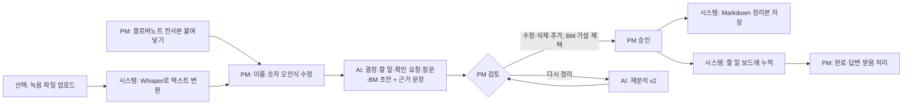

# 회의 후속 정리기 — 개인 과제 제출 문서

AX Campus 1기 · 개인 과제 · 박유선 · 2026-11-10
선택안: **3안 · AI 코딩 기반 시스템** (웹페이지 + Claude API)

> 저는 **PM**이 **요구사항이 확정되기 전 회의가 끝난 순간**부터 **할 일·개발자 확인 요청·BM 논의를 끝까지 챙기는 것**까지 수행하는 **회의 후속 정리 업무**를 선택했습니다. 현재 **클로바노트로 녹음하고 GPT로 요약해 노션에 붙여넣으며**, 할 일은 개인 노션, 개발자 확인 요청은 슬랙·지라에 나눠 관리합니다. 요약은 30분 안에 끝나지만, **요약이 자유 문장이라 기한과 미정 사항이 묻히고, 후속 항목이 세 곳에 흩어져 개발자 답 기한을 놓치는** 불편이 있습니다. 이번에는 **전사본 → 항목별 정리 초안 → PM 승인 → 한 곳(할 일 보드)에 누적**까지를 개선하고 싶습니다.

---

## ① 현재 업무 분석 (As-Is)

### 담당자별 프로세스맵

```mermaid
flowchart LR
  subgraph PM
    A[회의 진행 · 클로바노트 녹음] --> B[전사본을 GPT에 넣어 요약]
    B --> C[요약을 노션 회의록에 붙여넣기]
    C --> D[내 할 일을 개인 노션에 옮김]
    C --> E[개발자 확인 요청을 슬랙 DM·스레드로 보냄]
    C --> J[필요하면 지라·컨플 티켓 작성]
    D --> H[기한은 기억에 의존해 챙김]
    E --> I[답이 없으면 슬랙을 뒤져 다시 묻기]
  end
  subgraph 개발자
    E --> F[슬랙으로 답장]
    J --> K[티켓에서 확인]
  end
  subgraph MD·기획사·재무·데이터팀
    C --> G[BM·숫자 확인 요청을 따로 받음]
  end
```

### 쓰는 문서·데이터

| 단계 | 문서·데이터 | 도구 |
| --- | --- | --- |
| 회의 | 녹음, 전사본 | 클로바노트 |
| 정리 | 회의 요약 | GPT (자유 형식 요약) |
| 공유 | 회의록 | 노션 |
| 내 할 일 | 할 일, 기한 | 개인 노션 |
| 개발자 확인 요청 | 질문, 답, 기한 | 슬랙 DM·스레드, 지라·컨플루언스 티켓 |
| BM 논의 | 가격·배송비·프로모션 숫자 | 회의록 본문 (따로 기록하지 않음) |

### 단계별 문제

요약 자체는 30분 안에 끝나서 **시간은 큰 문제가 아니었습니다.** 문제는 요약 이후 단계입니다.

| 단계 | 문제 | 실제로 생긴 일 |
| --- | --- | --- |
| GPT 요약 | 형식이 매번 달라 "누가 언제까지"가 문장 속에 묻힘. "다음 주 수요일까지"가 날짜로 바뀌지 않음 | 개발자 답 기한을 놓침 |
| GPT 요약 | 결론이 안 난 의견도 매끄러운 문장으로 정리돼 결정처럼 보임. 근거 문장이 없어 원문과 대조하기 어려움 | **안 정해진 것을 정해진 것으로 알고 진행** |
| 후속 관리 | 할 일은 개인 노션, 확인 요청은 슬랙과 지라에 흩어져 "아직 답을 못 받은 것"을 한눈에 볼 수 없음 | **개발자 답 기한을 놓침**, 같은 질문 반복 |
| BM 논의 | 가격·배송비·수수료 이야기가 요약에서 빠지거나 한 줄로 줄어듦 | **BM·가격 논의가 기록 없이 사라짐**, 같은 논의를 다시 함 |

---

## ② 개선 설계 (To-Be)

### 무엇을 바꾸나

AI 요약은 이미 쓰고 있으므로, **요약을 "추적할 수 있는 항목"으로 바꾸는 것**에 집중했습니다.

- 자유 요약 대신 **정해진 칸**(결정사항 / 내 할 일 / 개발자 확인 요청 / 다시 물어볼 것 / BM)으로 나눠 받는다.
- 항목마다 **근거 문장**을 달아, PM이 원문과 대조해 검증한다.
- 기한은 회의 날짜 기준으로 **날짜로 바꾸되, 확정할 수 없으면 비워 두고 PM이 정한다.**
- 결론이 안 난 것은 결정사항이 아니라 **"다시 물어볼 것"**으로 분리한다.
- BM 논의는 **별도 칸**에 남기고, AI가 제안한 가설은 PM이 채택한 것만 저장한다.
- PM이 **승인한 것만** 저장되고, 할 일과 확인 요청이 **한 보드에 D-day 순으로** 쌓인다. 다시 정리해도 이전 버전과 완료 기록은 남는다.

### 함께 넣은 기능: 회의 다음에 PM이 바로 하는 일

회의 후속 정리를 만들고 나니, 회의 직후 PM이 실제로 이어서 하는 일 두 가지가 같은 화면에 있어야 쓸모가 있었습니다.

| 기능 | 지금 하는 방식 | 바꾼 방식 | AI가 하는 일 / 사람이 하는 일 |
| --- | --- | --- | --- |
| **오늘** (첫 화면) | 개인 노션·슬랙·지라를 각각 열어 확인 | 기한 지남·오늘·3일 안·미정을 한 화면에, 바로 완료 처리 | 시스템이 기한별로 모음 / PM이 완료 처리 |
| **정책 Q&A** | 노션·지라에서 정책 문서를 직접 찾아 읽음 | 질문하면 정책 문서만 근거로 답하고 조항·원문 인용 | AI가 답과 인용, 시스템이 인용문 원문 대조 / 없는 정책은 담당자 확인 |
| **문구 검수** | 기획서·공지를 쓰고 용어를 눈으로 확인 | 노션 'UI 문구 용어집'(실제 사이트 화면 표기·혼용 포인트)과 대조해 고칠 곳 표시, 결과 파일 저장 | 시스템이 문서와 관련된 화면 문구를 골라 전달, AI가 다른 표기·혼용 지점 지적 / PM이 고칠지 결정 |

### 선택안과 이유: 3안 · 웹페이지 + Claude API

| 안 | 판단 |
| --- | --- |
| 1안 Claude 스킬 | 빠르지만 할 일 보드처럼 계속 열어 보는 화면이 없음 |
| 2안 노션·시트 + 자동화 | 지금 쓰는 노션과 가깝지만, 항목별 검토·승인 화면과 버전 이력을 만들기 어려움 |
| **3안 웹페이지 + API** | 전사본 입력 → 근거 대조·수정 → 승인 → 보드까지 한 화면 흐름으로 만들 수 있음. 회의마다 반복 사용 |

### To-Be 프로세스맵



### AI·시스템·사람의 역할

| 누가 | 하는 일 | 하지 않는 일 |
| --- | --- | --- |
| AI (Claude, 녹음 변환만 OpenAI Whisper) | 전사본 → 초안, 근거 문장 인용, BM 가설 2~3개 제안, 녹음 → 텍스트 | 결정, 날짜 추측, 전사본에 없는 숫자 만들기 |
| 시스템 | 필수값 확인, 날짜 형식 검사, 버전·이력 저장, 할 일 보드·D-day 계산 | 승인 없이 저장 |
| PM (사람) | 초안 검증·수정, 미정 기한 결정, BM 가설 채택, 승인, 완료 처리 | — |

---

## ③ 자동화 구현물

- 폴더: `meeting-followup/` (실행 방법은 `README.md`)
- 예제 입력: `samples/가상회의_전사본.txt`, `samples/가상회의_녹음.m4a` (가상 회사·인물, 2분 17초)
- API 키(`ANTHROPIC_API_KEY`, 선택 `OPENAI_API_KEY`)는 `.env`에만 두며 제출물에 넣지 않았습니다.

```bash
npm install
cp .env.example .env   # ANTHROPIC_API_KEY 입력
npm start              # http://localhost:3000
```

### 작동한 기능과 남은 문제

| 구분 | 내용 |
| --- | --- |
| 작동 확인 | 전사본 입력 → 초안 → 검토·수정 → 승인 → `output/*.md` 저장 → 할 일 보드 누적 |
| 작동 확인 | 재분석 시 v2 생성, 이전 승인본은 `대체됨`으로 보존, 완료한 항목은 그대로 유지 |
| 작동 확인 | 이미 대체된 버전 재승인 거절, 필수값 누락 시 거절 |
| 작동 확인 | 모든 변경이 `data/history.jsonl`에 쌓임 |
| 작동 확인 | 실제 Claude(`claude-opus-5-5`)로 예시 회의 정리: 약 30초, 근거 문장 10개 모두 원문과 일치, 상대 기한 5개(이번 주 목·금, 다음 주 월·화·수) 모두 정확한 날짜로 변환, 기한 언급 없는 2개는 "미정"으로 남김 |
| 미확인 | 녹음 변환은 OpenAI 키가 없어 실제로 돌려 보지 못함 (버튼이 꺼지고 전사본 붙여넣기 안내가 나옴) |
| 작동 확인 | 정책 Q&A: 정책에 있는 질문 3개는 조항과 원문 인용으로 답하고 인용 모두 원문 일치, 정책에 없는 질문(팬사인회 좌석 배치)은 "찾을 수 없어요"와 확인할 담당자 안내 (4~7초) |
| 작동 확인 | 문구 검수: 예시 공지에서 규칙 검사로 10건(예판, 팬싸, 무배, 포카, CS센터 등) 찾음. 영어 문구에서는 AI가 presale→Pre-order 등 5건 찾음. 결과는 `output/검수_*.md`로 저장 |
| 작동 확인 | 노션 연동(개인 워크스페이스 테스트 DB): 회의 승인 시 회의록 LIST에 페이지(속성 + 결정·할 일·확인 요청·BM 본문)와 주간 캘린더에 '대기' 카드 4개 생성, 카드는 회의록과 연결. 앱에서 완료·되돌리기 하면 카드가 '완료'·'대기'로 바뀜. 재분석 v2 승인 시 v1 회의록은 '대체됨', v1의 미완료 카드 3개는 휴지통, 완료 카드는 유지, v2 카드 5개 생성 |
| 작동 확인 | 정책 Q&A가 노션 운영정책 페이지 4개를 직접 읽어 답하고, 인용문이 노션 원문과 일치 |
| 남은 문제 | 회사 노션은 관리자 권한이 필요해 개인 워크스페이스의 테스트 DB로만 확인함. 노션 → 앱 방향(노션에서 카드를 완료하면 앱에 반영)은 아직 없음. 정책은 가상 자료, UI 문구 용어집은 현재 JP몰만 입력됨 |
| 남은 문제 | 화자 구분 없음, 로그인 없음, 캘린더·Jira·노션 자동 전송 없음, 25MB 넘는 녹음은 나눠 올려야 함 |

### 참고한 오픈소스

GitHub에서 별이 많은 회의 정리 도구를 확인했습니다 (2026-11-10 기준). 대부분 **녹음 → 전사 → 요약**까지만 하고, PM 관점의 할 일·확인 요청 추적과 승인·이력은 없어 이 부분을 직접 설계했습니다.

| 저장소 | 별 | 참고한 점 |
| --- | --- | --- |
| [openai/whisper](https://github.com/openai/whisper) | 112k | 녹음 → 텍스트 변환 방식 |
| [Zackriya-Solutions/meetily](https://github.com/Zackriya-Solutions/meetily) | 32.6k | 로컬 회의 노트·AI 요약 흐름 |
| [m-bain/whisperX](https://github.com/m-bain/whisperX) | 25.2k | 화자 구분 (다음 개선 후보) |
| [fastrepl/anarlog](https://github.com/fastrepl/anarlog) | 9.8k | 노트를 문서처럼 고치고 Markdown으로 내보내기 |

---

## ④ AI 도구 활용 범위

| 단계 | 사용한 AI | AI가 한 것 | 제가 판단·결정한 것 |
| --- | --- | --- | --- |
| 주제 선정 | Claude (Claude Code) | 과제 조건 정리, GitHub 유사 도구 조사·별 수 확인 | 케이타운포유 경험에서 업무 선택, 범위(할 일·개발자 확인·BM) 결정 |
| 업무 분석 | Claude | As-Is·To-Be 프로세스맵 초안, 문제 표 정리 | 실제 흐름과 문제 확인·수정 |
| 설계 | Claude | AI·시스템·사람 역할 분담 초안 | 승인 없이 저장하지 않기, 날짜 추측 금지, BM 가설은 PM이 채택 같은 규칙 결정 |
| 구현 | Claude Code | 서버·화면 코드, 정리 프롬프트, 저장 구조 작성 | 화면 흐름과 항목 구성 지정, 결과 확인 |
| 예제 자료 | Claude Code, macOS 음성 합성 | 가상 회의 전사본 작성, 녹음 파일 생성 | 실제 회의 대신 가상 자료를 쓰기로 결정 (민감정보 보호) |
| 정책·용어집 | Claude Code | 가상 정책 문서 4개 작성 | 실제 회사 자료 대신 가상 자료를 쓰기로 결정, 다룰 정책 범위 선정 |
| 서비스 안 AI | Claude (`claude-opus-5-5`), 선택: OpenAI Whisper | 회의 정리 초안, BM 가설 제안, 정책 답변, 문구 검수 (Claude), 녹음 변환 (Whisper) | 모든 초안은 PM 검토·승인 후 저장 |
| 문서 | Claude | 제출 문서 초안 | 내용 확인과 최종 수정 |
